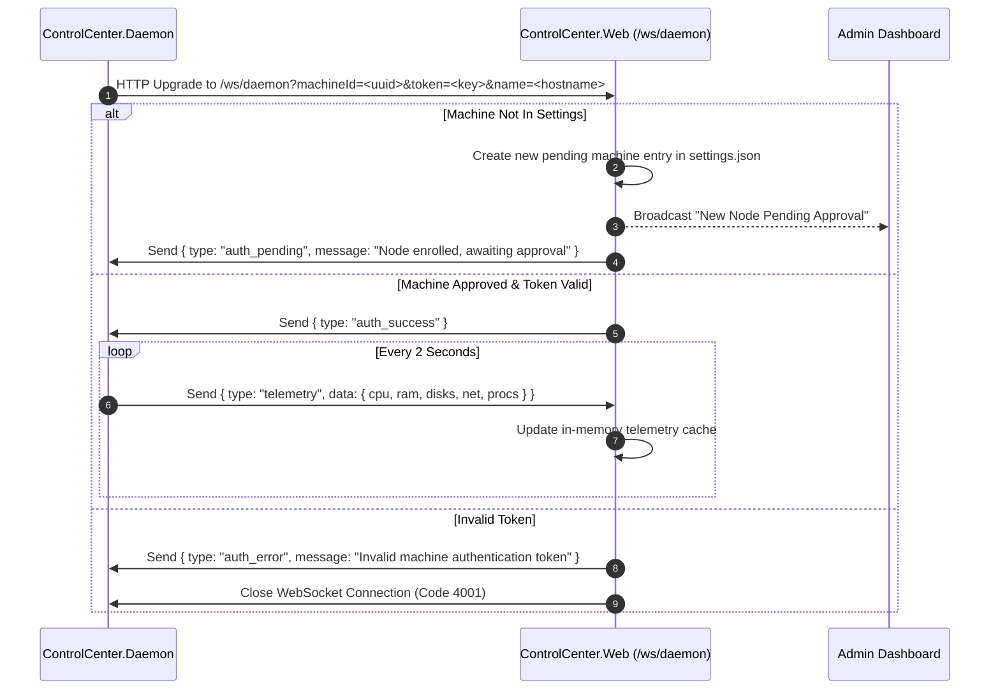

# Daemon Agent Subsystem & Zero-Trust Protocol

This document details the bidirectional WebSocket protocol between `ControlCenter.Daemon` (client node agent) and `ControlCenter.Web` (central server).

---

## 1. Zero-Trust Connection Philosophy

Rather than requiring the server to reach into nodes (which requires port forwarding and firewall holes), ControlCenter nodes connect **outward** to the server over persistent WebSockets:

```
┌────────────────────────────────────────────────────────┐
│               ControlCenter Server (Port 4382)         │
│             WebSocket Endpoint: /ws/daemon             │
└──────────────▲──────────────────────────▲──────────────┘
               │                          │
               │ Persistent WSS Tunnel    │ Persistent WSS Tunnel
               │                          │
┌──────────────┴──────────────┐ ┌─────────┴────────────────────┐
│ Node A: S2600CP (Server)    │ │ Node B: Clyocloud (Client)   │
│ ControlCenter.Daemon        │ │ ControlCenter.Daemon         │
│ MachineID: 495f5683...      │ │ MachineID: e2bc7986...       │
└─────────────────────────────┘ └──────────────────────────────┘
```

---

## 2. Zero-Trust Handshake & Auto-Enrollment

When a daemon connects to `wss://<server-ip>:4382/ws/daemon`:



---

## 3. Telemetry Payload Format

The daemon periodically streams hardware metrics serialized in JSON:

```json
{
  "type": "telemetry",
  "machineId": "495f5683-1b75-467f-b2d9-bab73f2e60a6",
  "timestamp": "2026-08-17T02:00:00.000Z",
  "data": {
    "os": "Arch Linux (Linux 6.10.3-arch1-1)",
    "hostname": "clyocloud",
    "uptimeSeconds": 142380,
    "cpuUsagePercent": 14.5,
    "ramUsagePercent": 42.8,
    "totalRamBytes": 33554432000,
    "usedRamBytes": 14361296896,
    "ipAddresses": [
      "192.168.178.67",
      "100.64.0.12"
    ],
    "disks": [
      {
        "mount": "/",
        "filesystem": "ext4",
        "totalGigabytes": 915.8,
        "usedGigabytes": 234.1,
        "freeGigabytes": 681.7
      }
    ],
    "network": {
      "rxBytesPerSecond": 1048576,
      "txBytesPerSecond": 524288
    },
    "processes": [
      { "name": "node", "pid": 2046260, "cpuPercent": 2.1, "ramBytes": 84934656 }
    ]
  }
}
```

---

## 4. Certificate Fingerprint Pinning

In zero-trust and self-hosted environments with self-signed SSL certificates, the daemon supports pinning the SHA-256 fingerprint of the server certificate:

```bash
controlcenter-daemon --address 100.64.0.4:4382 --fingerprint "E95CD8594F4BCE1786046E8F1B097F0D1ABD346712873DA1C7E8529CDC5C1991"
```

During the TLS handshake, the daemon computes the SHA-256 digest of the server's public certificate and aborts if it does not match, completely neutralizing Man-In-The-Middle (MITM) attacks.
